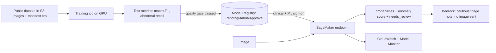

# abnormality-detection-aws

Classification and triage of abnormalities in capsule-endoscopy (gastrointestinal tract) images, redesigned
as an **end-to-end ML solution** for **Amazon SageMaker** and **Amazon Bedrock**.

It began as an MSc thesis (University of Southampton): *A Deep Learning Approach for Accurate Classification
of Abnormalities in Intestinal Tracts*, a VGG-16 classifier over 47,238 labelled images in 14 classes
(83% accuracy). This repository keeps that model as the baseline and fixes the evaluation, then adds what a
real system needs: leakage-safe data splits, calibration, an anomaly score, human-in-the-loop routing,
a serving API, ONNX export, a SageMaker pipeline with a quality gate, governance and cost control.

> **Research prototype. Not a medical device. Not for clinical use.** Any real use needs clinical
> validation, regulatory review (for example MHRA in the UK) and clinical-safety sign-off.
>
> **Status.** The package, training loop, API server, SageMaker scripts, ONNX export and Bedrock client are
> covered by 37 automated tests that run locally on CPU with a tiny *synthetic* dataset (no medical data, no
> downloads). The Terraform, SageMaker Pipeline and endpoint scripts have **not been run against a live AWS
> account yet**, and the model has **not been retrained on the real dataset** in this repository.
> See [docs/DEPLOY_AWS.md](docs/DEPLOY_AWS.md).

## What it does

* Trains a 14-class classifier (`vgg16` baseline as in the thesis; `resnet50` and `densenet121` options).
* **Splits by video**, not by frame, to prevent near-duplicate frames leaking from train to test.
* Applies **class weights** (inverse frequency) in the loss, and reports macro-F1, balanced accuracy, MCC,
  per-class recall, confusion matrix and calibration error, not just accuracy.
* Calibrates probabilities with temperature scaling.
* Builds an **anomaly score**: probability that an image is *not* normal-like (clean mucosa, anatomical
  landmarks, poor view), with sensitivity, specificity and AUROC for abnormal-vs-normal.
* Routes uncertain cases to a human (`needs_review`): low confidence, an abnormal score near the decision
  boundary, or a poor-view image.
* Serves predictions over HTTP (`/ping`, `/invocations`) and exports to ONNX.
* Uses **Amazon Bedrock** to write a cautious triage note from the *model outputs* (never the image) and to
  draft a model card from aggregate metrics. Every note ends with the prototype disclaimer.



## Quick start (CPU, no downloads, no AWS)

```bash
python -m venv .venv && source .venv/bin/activate
pip install -e ".[dev]"
pytest                                                  # 37 tests, ~1 min

# smoke test on tiny synthetic images (the scores are meaningless; this only proves the pipeline works)
abnormality-detection synthetic --out data/synthetic
abnormality-detection train --data data/synthetic --out artifacts/model --image-size 64 --epochs 2 --no-pretrained
abnormality-detection predict --model artifacts/model --image data/synthetic/00_000.png --note --dry-run
abnormality-detection model-card --model artifacts/model --dry-run
MODEL_DIR=artifacts/model uvicorn abnormality_detection.serve:app --port 8080 &   # needs: pip install -e ".[serve]"
curl -s localhost:8080/invocations -H 'content-type: image/png' --data-binary @data/synthetic/00_000.png
```

Using the real data: download the public **Kvasir-Capsule** dataset yourself, create `manifest.csv`
(`filename,label,video_id`) and run `abnormality-detection train --data <folder> --epochs 10`. Details in
[docs/DATA_GOVERNANCE.md](docs/DATA_GOVERNANCE.md).

## Deploy on AWS

1. `cd infra/terraform && terraform init && terraform apply -var-file=example.tfvars`
2. Upload the dataset to `s3://<bucket>/kvasir-capsule/` (images + `manifest.csv`)
3. `make package && python mlops/pipeline.py --role-arn <role> --bucket <bucket> --data-uri s3://<bucket>/kvasir-capsule/ --start`
4. Review metrics, approve the model in the registry, then `python scripts/deploy_endpoint.py ...` (serverless CPU by default)
5. `python scripts/invoke_endpoint.py <image>`; when finished `python scripts/delete_endpoint.py`

## Layout

| Path | Purpose |
| --- | --- |
| `src/abnormality_detection/` | labels, data and splits, models, training, evaluation, calibration, predictor, API, ONNX, Bedrock, CLI |
| `mlops/` | SageMaker `train_sm.py`, `inference_sm.py`, `pipeline.py` |
| `scripts/` | deploy, invoke, delete endpoint; package source |
| `infra/terraform/` | S3, least-privilege IAM, model registry, budget alert |
| `docs/` | architecture, ML strategy, model card, data governance, deployment, thesis mapping |
| `tests/` | 37 tests (data, model, metrics, calibration, training, API, SageMaker scripts, ONNX, Bedrock, CLI) |

## Licence

MIT for the code. The dataset and any model trained on it follow the dataset's own licence.
