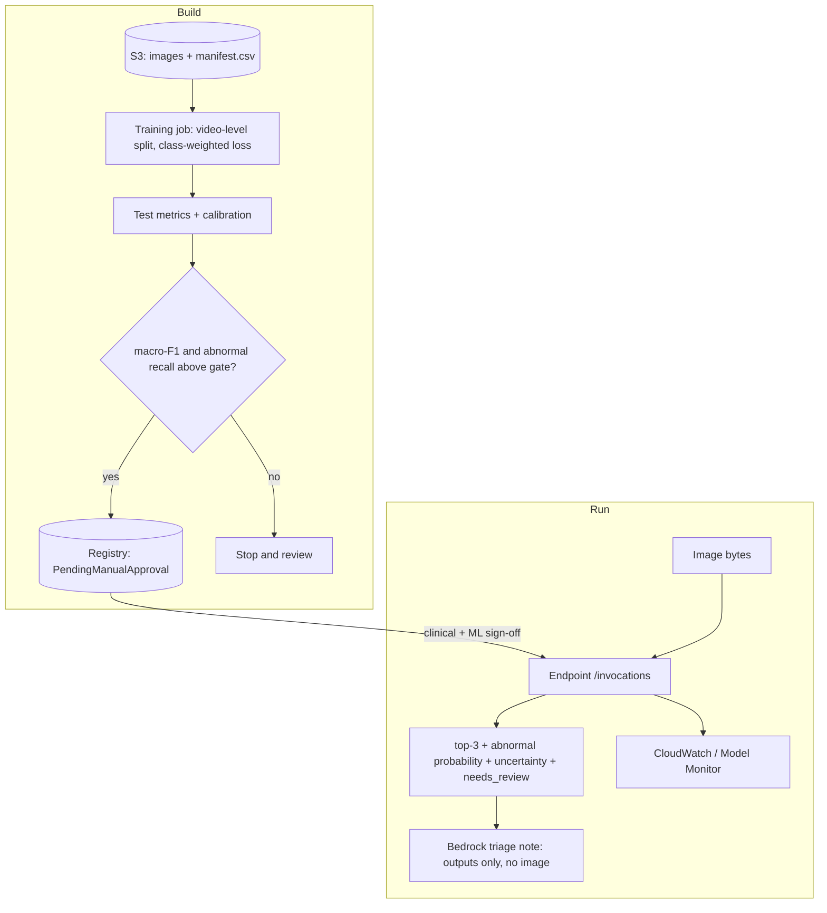

# Architecture

| Layer | Service | Why |
| --- | --- | --- |
| Storage | **Amazon S3** (private, versioned, SSE) | dataset, model artefacts |
| Training | **SageMaker training job** (PyTorch container, `ml.g4dn.xlarge` GPU) | VGG-16 head training is light; one GPU is enough |
| Orchestration | **SageMaker Pipelines** | train -> quality gate -> register |
| Registry | **SageMaker Model Registry** (`PendingManualApproval`) | a human must approve before any deployment |
| Serving | **SageMaker serverless inference** (CPU, 6 GB) by default; real-time GPU optional | low volume, scales to zero |
| Edge / portability | **ONNX** export | replaces the thesis TFLite conversion; runs in onnxruntime, SageMaker Neo, edge devices |
| Triage notes | **Amazon Bedrock** Converse API (+ Guardrail) | cautious text from model *outputs* only |
| Observability | CloudWatch, Model Monitor | latency, errors, input drift |

## Design decisions

1. **Keep VGG-16 as the baseline**, with the same frozen convolutional base and a single dense softmax head,
   so the new numbers are comparable with the thesis. Alternatives are one flag away.
2. **Honest evaluation first.** Video-level splits, no test-time augmentation, class-weighted loss that is
   really applied, macro metrics and calibration. See FROM_THESIS.md.
3. **Anomaly view without a second model.** The abnormal probability is the probability mass on non-normal
   classes, so it stays consistent with the classifier and can be evaluated with sensitivity/specificity.
4. **Human in the loop by design.** `needs_review` is set for low confidence, borderline abnormal scores and
   poor views; the language model can never change a classification.
5. **State dicts, not pickles.** Weights are stored as `model.pt` (loaded with `weights_only=True`) and a
   readable `meta.json`.
6. **Privacy by construction.** Images are processed in memory; Bedrock gets only labels and numbers, and
   forbidden keys (filenames, ids) are rejected.
7. **Serverless first**, with a clear switch to a real-time GPU endpoint if latency demands it.

## Alternatives considered

* *Autoencoder / one-class anomaly detection*: attractive when abnormal labels are scarce, but here we have
  labelled abnormal classes, so a supervised score is stronger and easier to validate. A one-class model on
  normal mucosa is a sensible future comparison.
* *Fine-tuning the whole network* or a vision transformer: likely better but needs more compute and careful
  regularisation; tracked in the ML strategy.
* *Sending the image to a multimodal foundation model*: rejected for privacy and validation reasons.
